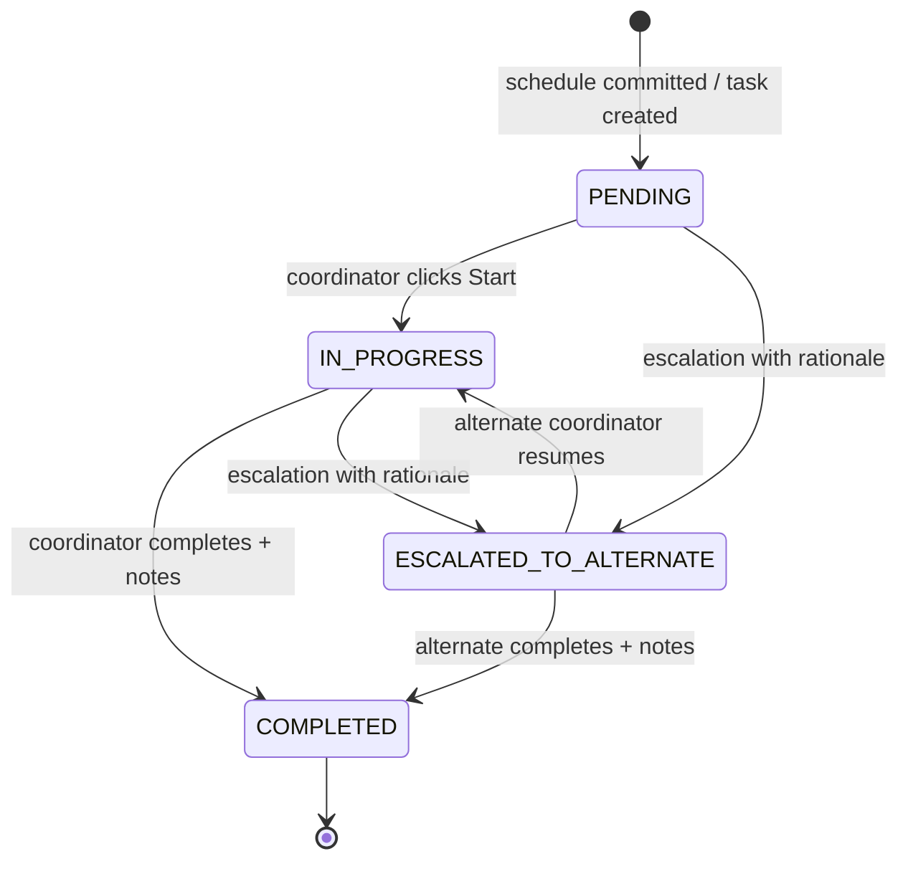
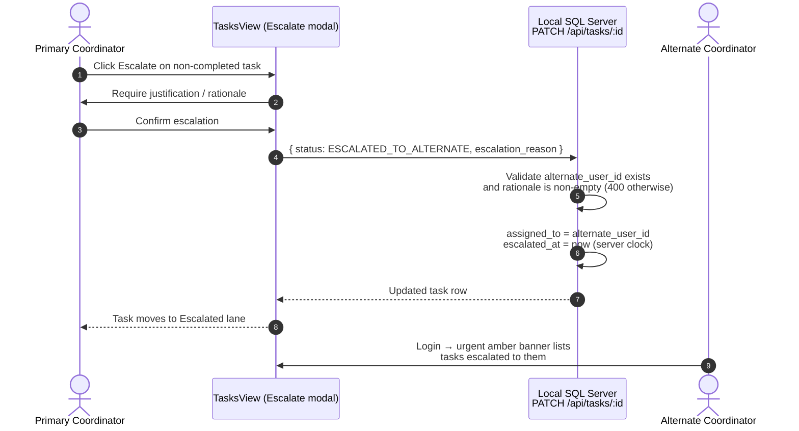

# Examination Operations Workflow (WORKFLOW.md)

Authoritative workflow reference for the Acharya360 Exam Smart Dashboard (ExamTrack) examination lifecycle: from Excel timetable ingestion through automated task generation, coordinator execution, and escalation. An interactive, theme-aware version of the end-to-end lifecycle is available at [diagrams/examtrack-workflow.html](diagrams/examtrack-workflow.html) (source spec: [diagrams/examtrack-workflow.workflow.json](diagrams/examtrack-workflow.workflow.json)). For system structure see [ARCHITECTURE.md](ARCHITECTURE.md); for RBAC policy details see [SECURITY.md](SECURITY.md).

---

## 1. Workflow Actors

| Actor | System Role | Workflow Responsibilities |
| :--- | :--- | :--- |
| **COE / DYCOE / ACOE** | `Super Admin` (`isSuperAdmin`) | Excel ingestion, timetable commit, program ↔ coordinator mapping, university-wide monitoring, final escalation oversight. |
| **Program Coordinator** | `COORDINATOR` (primary) | Executes the 4-phase task suite for assigned programs; updates status/notes; escalates blocked tasks. |
| **Alternate Coordinator** | `COORDINATOR` (alternate) | Receives escalated tasks; sees urgent banner alert on the Tasks view. |

Scoped visibility: coordinators only see schedules and tasks for programs where they are the primary or alternate coordinator ([App.tsx](../src/App.tsx) `userProgs` / `accessibleSchedules` / `accessibleTasks`).

---

## 2. End-to-End Lifecycle

```mermaid
flowchart TD
    A[Super Admin uploads<br/>Excel timetable] --> B[SheetJS parser<br/>header normalization + validation]
    B --> C{Preview:<br/>valid / error rows}
    C --> D[Commit schedules<br/>addSchedules()]
    D --> E{Auto-generate<br/>4-phase task suites?}
    E -- Yes --> F[generateDefaultTasksForSchedule()<br/>per committed schedule]
    E -- No --> G[Schedules only]
    F --> H[4 milestone tasks per schedule<br/>PENDING · primary assignee<br/>due = exam date]
    G --> I[Coordinator daily execution]
    H --> I
    I --> J[Kanban: Start → IN_PROGRESS]
    J --> K{Task on track?}
    K -- Yes --> L[Complete → COMPLETED + notes]
    K -- Blocked / overdue --> M[Escalate with rationale]
    M --> N[PATCH /api/tasks/:id<br/>server-side enforcement]
    N --> O[assigned_to → alternate<br/>escalated_at stamped]
    O --> P[Alternate coordinator banner alert<br/>+ COE Critical Alerts metric]
    P --> Q[Alternate resumes execution]
    Q --> L
```

---

## 3. Phase 1 — Excel Ingestion (Super Admin Only)

1. Super Admin opens **Upload Excel** and selects a university timetable workbook (`.xlsx` / `.xls`).
2. `excelParser.ts` (SheetJS) parses rows with resilient, case-insensitive header normalization (`PKGNo`, `PaperCode`, `SM_Subject_Name`, `Student Count`, `Exam Date`, `AM_PM`, …).
3. A preview summary distinguishes valid rows from error rows before commit.
4. On confirm, `handleCommitSchedules(newSchedules, autoGen)` ([App.tsx](../src/App.tsx)) calls `db.addSchedules()` then, when auto-generation is checked, spawns task suites.
5. Access gate: the upload view is restricted to `isSuperAdmin` (COE / DYCOE / ACOE).

---

## 4. Phase 2 — Automated 4-Phase Task Generation

Implemented in `generateDefaultTasksForSchedule()` ([localDb.ts](../src/services/localDb.ts)); invoked per committed schedule when auto-generation is enabled, or on demand from the timetable view.

**Generation rules:**

- **Coordinator precondition**: the program must have both `primary_coordinator_id` and `alternate_coordinator_id` assigned; otherwise generation throws (`Assign primary and alternate coordinators before generating tasks.`).
- **Idempotency**: a milestone title already present for the same `schedule_id` is skipped, so re-running generation never duplicates tasks.
- **Defaults**: `status = PENDING`, `assigned_to = primary coordinator`, `alternate_user_id = alternate coordinator`, `due_date = schedule exam date`.

**Exact milestone titles (must not be renamed):**

1. `Question Paper Printing & Secure Vault Packaging`
2. `Hall Seating Plan, Attendance Sheets & Roll Labels`
3. `Invigilation Duty Assignment & Verification`
4. `Answer Booklet Collection & Counterfoil Verification`

---

## 5. Phase 3 — Task Execution (Coordinator)

Coordinators work the **Tasks & Workflow** Kanban ([TasksView.tsx](../src/components/tasks/TasksView.tsx)) with four lanes and due-date quick filters (`ALL`, `OVERDUE`, `TODAY`, `NEXT_48H`, `THIS_WEEK`).

### 5.1 Task State Machine



### 5.2 State Definitions

| Status | Meaning | Set By |
| :--- | :--- | :--- |
| `PENDING` | Milestone generated, not yet started. | Auto-generation |
| `IN_PROGRESS` | Primary (or alternate, post-escalation) coordinator actively working. | Coordinator (Start) |
| `COMPLETED` | Milestone finished; completion notes appended. | Coordinator |
| `ESCALATED_TO_ALTERNATE` | Blocked/overdue; responsibility transferred to alternate with recorded rationale. | Coordinator → server |

---

## 6. Escalation Protocol

### 6.1 Sequence



### 6.2 Enforcement Rules

Enforced server-side in `app.patch('/api/tasks/:id')` ([server.js](../server.js)) — client tampering cannot bypass them:

- Status must be one of the four enum values (`PENDING`, `IN_PROGRESS`, `COMPLETED`, `ESCALATED_TO_ALTERNATE`).
- Escalation **requires** a non-empty `escalation_reason` and a program `alternate_user_id`; otherwise the request is rejected with `400`.
- On escalation the server sets `assigned_to = alternate_user_id`, keeps `alternate_user_id`, and stamps `escalated_at` with the server timestamp.
- Non-escalation updates performed by a `COORDINATOR` role cannot modify `assigned_to`, `alternate_user_id`, or `escalated_at` (those fields are stripped).
- The Escalate action is only offered in the UI when the task is not `COMPLETED` or already `ESCALATED_TO_ALTERNATE`.

### 6.3 Visibility of Escalations

- The alternate coordinator sees an amber **urgent banner** on the Tasks view listing tasks escalated to them (`TasksView.tsx` `myAlternateEscalations`).
- Escalated and overdue tasks feed the **Critical Alerts** counter in the role-aware `MetricsGrid` for oversight.

---

## 7. Monitoring & Metrics

The `MetricsGrid` + `CommandCenter` tiles are role-aware:

- **Super Admin**: university-wide totals (exams, students scheduled, active tasks, completion %, critical alerts).
- **Coordinator**: same KPIs computed only over their assigned programs.
- Escalation and overdue counts drive the critical alert badge so COE/DYCOE/ACOE can arbitrate unresolved escalations.

---

## 8. Implementation Reference Map

| Workflow Step | File | Symbol |
| :--- | :--- | :--- |
| Commit schedules + auto-gen orchestration | [src/App.tsx](../src/App.tsx) | `handleCommitSchedules`, `handleGenerateDefaultTasks` |
| Service layer (authoritative: local SQL server) | [src/services/db.ts](../src/services/db.ts) | `db = new LocalDBService()` |
| Task generation + escalation client calls | [src/services/localDb.ts](../src/services/localDb.ts) | `generateDefaultTasksForSchedule`, `escalateTask`, `updateTaskStatus` |
| Server enforcement (SQL Server / T-SQL) | [server.js](../server.js) | `PATCH /api/tasks/:id`, `POST /api/tasks` |
| Kanban execution UI | [src/components/tasks/TasksView.tsx](../src/components/tasks/TasksView.tsx) | lanes, Escalate modal, alternate banner |
| Types & status enum | [src/types/index.ts](../src/types/index.ts) | `TaskStatus`, `ExamTask` |
| RBAC scoping | [src/App.tsx](../src/App.tsx) | `userProgs`, `accessibleSchedules`, `accessibleTasks` |
